

  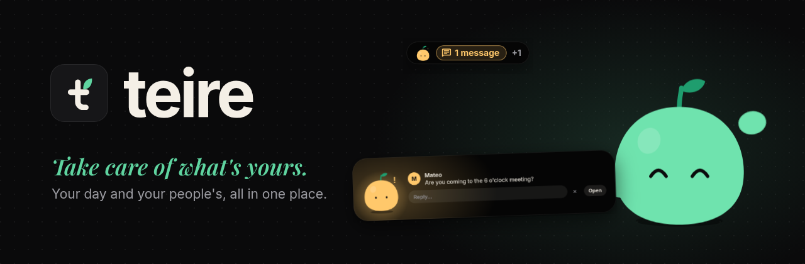

  
  
  
  

  
  

  <a href="https://useteire.app"><b>useteire.app</b></a> &nbsp;·&nbsp;
  <a href="#what-it-does"><b>What it does</b></a> &nbsp;·&nbsp;
  <a href="#the-island"><b>The island</b></a> &nbsp;·&nbsp;
  <a href="#download"><b>Download</b></a> &nbsp;·&nbsp;
  <a href="#faq"><b>FAQ</b></a>

  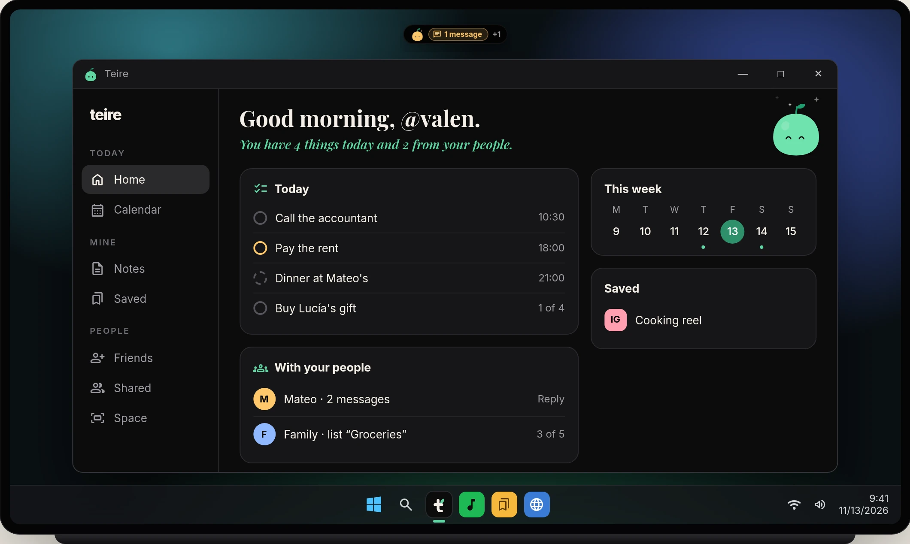

  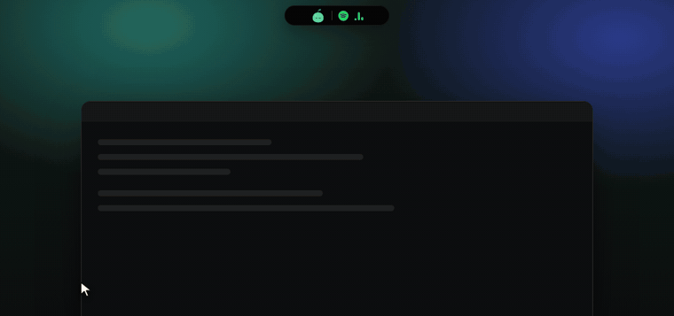

# Teire: your day and your people's, in one place

**Teire** is a **free app to organize your day and share it with your friends**: tasks, reminders, habits, a calendar, live shared lists, chat, and an **island** at the top of your screen that saves anything in one gesture. For **Windows, Linux, Android and iPhone**. Made by an independent developer in Argentina.

> **Heads up:** Teire is available in English and Spanish, and picks the language of your device (you can change it in Profile → Appearance). **Teire AI** (the voice and text assistant) works in Spanish only for now.

The name comes from the Japanese 手入れ (*teire*): to look after something with care, like a plant. That's the little leaf.

<table>
<tr>
<td width="33%" valign="top">

**Your day** 
Tasks, reminders and calendar in one place, with a focus mode to help you concentrate.

</td>
<td width="33%" valign="top">

**Your people** 
Lists, chats and spaces you complete live with your friends and family.

</td>
<td width="33%" valign="top">

**What you save** 
Links, photos and screenshots saved in one gesture. No ads, and it works offline.

</td>
</tr>
</table>

## Why Teire

Your day is usually spread over five apps: notes in one, tasks in another, a calendar in a third, and the chat with your people in yet another. And the nice-looking ones are almost always paid or full of ads. **Teire puts it all in one place, it's free and it has no ads.**

- **On all your devices:** Windows, Linux, Android and iPhone, with the same account.
- **With your people:** lists and chats that update live.
- **No fuss:** the island at the top of your screen saves what you copy with one gesture.

## What it does

<table>
<tr>
<td width="56%">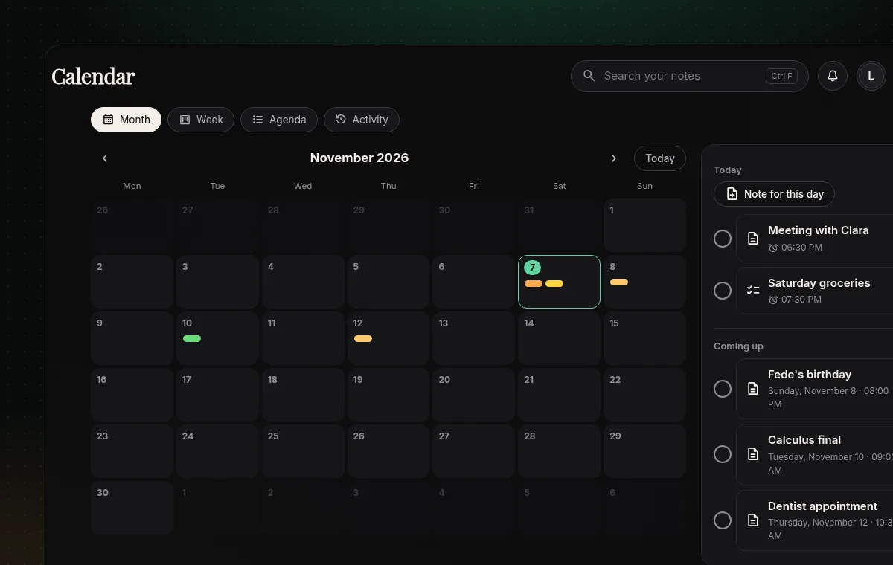</td>
<td width="44%" valign="middle">

### Your day, in order

**Today** puts your tasks, reminders and events in a single list, and tells you how many things you have today and how many come from your people. A calendar with **Month, Week and Agenda** views. Reminders reach you even with the window closed and repeat until you tap **Done**. With **focus mode** you pick what to work on and notifications wait. Add **habits** (drink water, walk, read or your own): you check them off once a day, Teire counts your **streak** and, if you give one a time, it nudges you. Your habits **sync between your devices**. And what you jot down on the go lands in an **Inbox** to sort out later: Today, This week or Someday.

</td>
</tr>
<tr>
<td width="44%" valign="middle">

### Your people, live

Share a list or a note by their `@username` and watch them fill it in, letter by letter. **With your people** shows the messages you still need to answer, the shared lists that are moving forward, and who's online. The **whiteboard** is a full-screen canvas: you see what others draw while they draw it.

</td>
<td width="56%">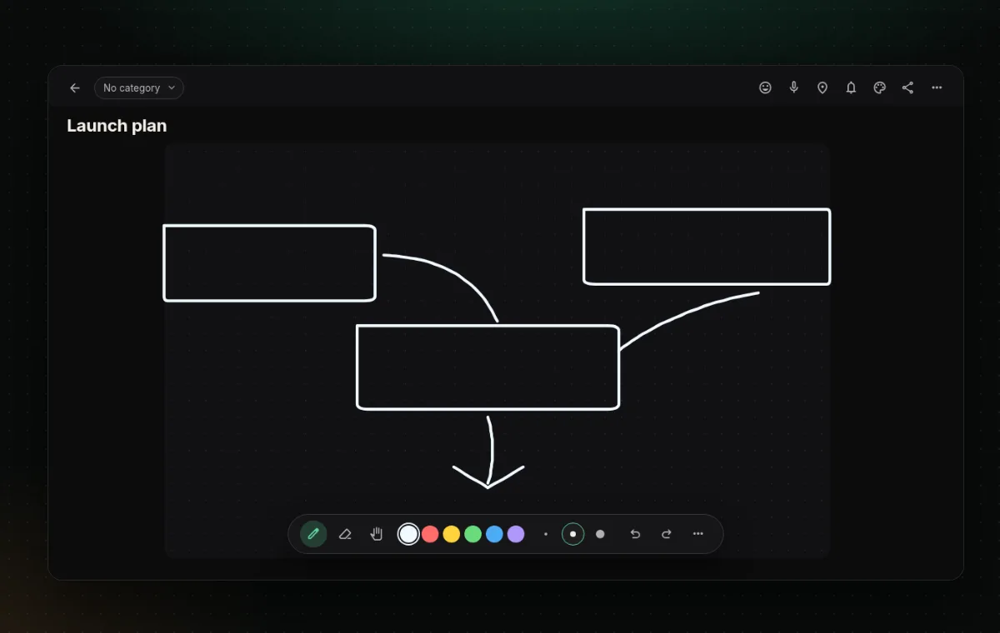</td>
</tr>
<tr>
<td width="56%">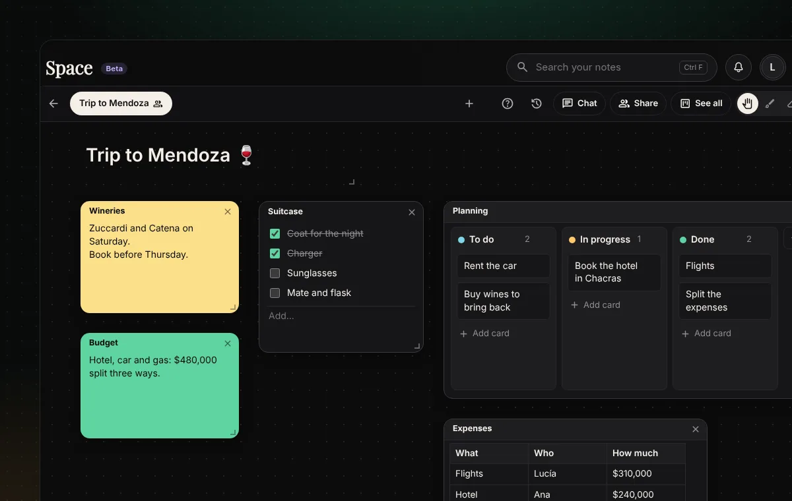</td>
<td width="44%" valign="middle">

### Space

A place for your group: a canvas with **notes, files, kanban boards, tables, a calendar and whiteboards**, plus chat and live cursors. If two people type at once, the changes merge; and the **history** brings back anything that was removed. Invite anyone with a **24-hour link**, even if they don't have Teire.

</td>
</tr>
<tr>
<td width="44%" valign="middle">

### Save on the fly

Reels, videos, links, text and screenshots, grouped by day. Paste with `Ctrl+V` or drag them in, and turn them into a note whenever you want. On your phone, **Share → Teire** from any app.

</td>
<td width="56%">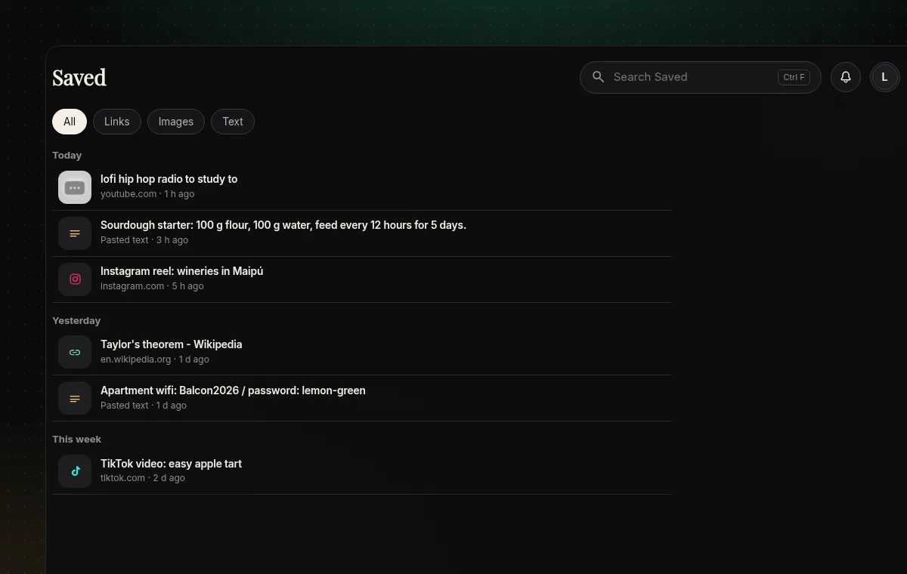</td>
</tr>
<tr>
<td width="56%">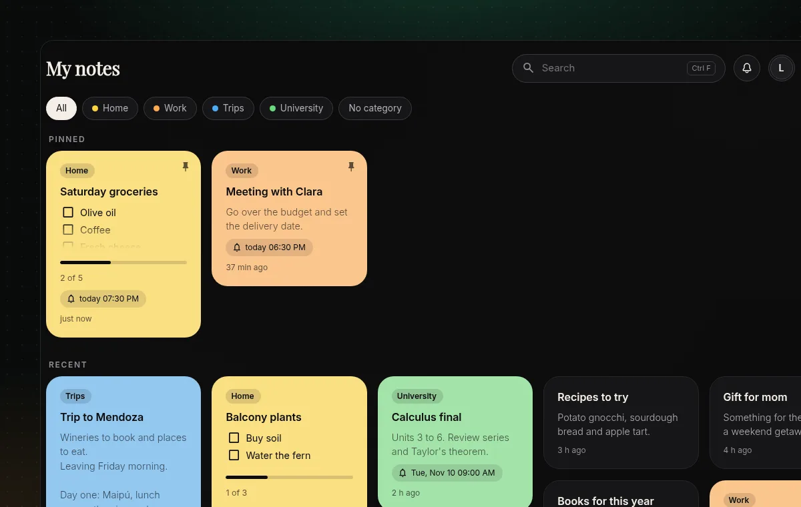</td>
<td width="44%" valign="middle">

### And your notes, at a glance

Notes, lists and whiteboards colored by **category**. Pinned ones go on top, and each card tells you how much of a list is left or when the reminder is due. With images, voice notes, places and `[[links]]` between notes.

</td>
</tr>
<tr>
<td width="44%" valign="middle">

### Just ask for it

On your computer, `Ctrl K` opens the **command bar**: search screens, notes, reminders and friends, or create a note, a habit or a focus without touching the mouse. And if you type a sentence, Teire AI understands it: *"create a grocery list with bread and milk"*, *"remind me tomorrow at 9 and send it to Fede"*, *"tell Fede I'm running late"*. You can also say **"Oye Teire"**: the voice is off by default and you turn it on in Profile → Teire AI. Sharing a note always asks you to confirm. Teire AI works in **Spanish only** for now.

</td>
<td width="56%">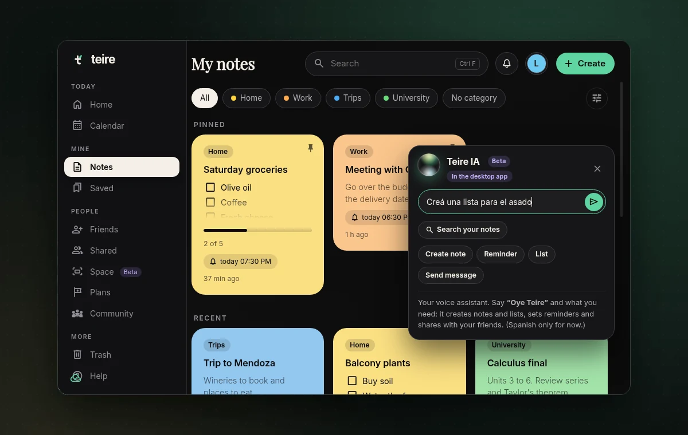</td>
</tr>
<tr>
<td width="56%">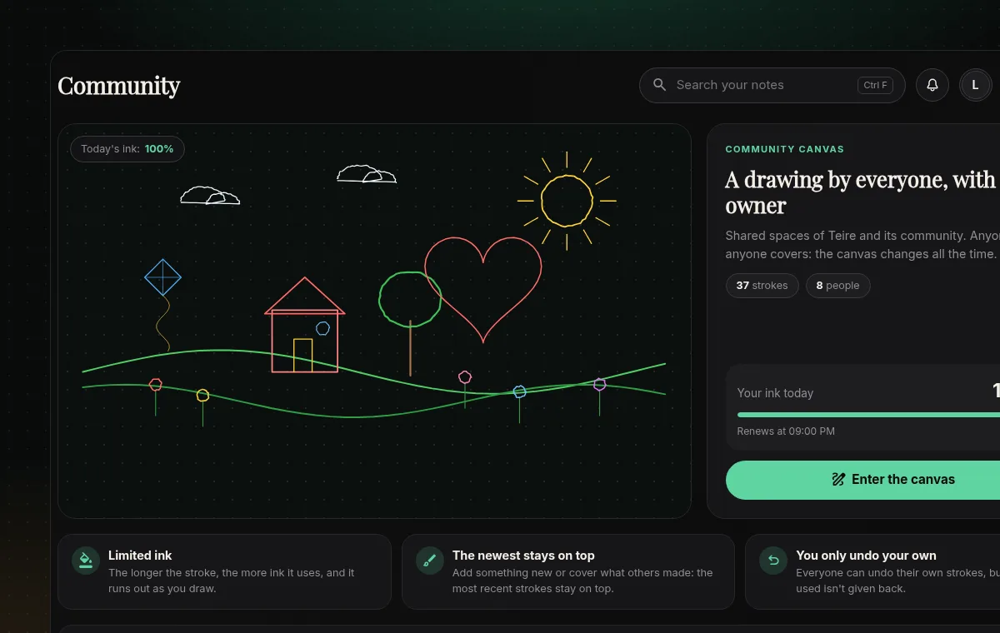</td>
<td width="44%" valign="middle">

### Community

A **canvas shared by everyone**, with no owner, r/place style: every day you get a little ink to draw or cover what others made. You see who took part and can open their profile.

</td>
</tr>
</table>

### And more

<table>
<tr>
<td width="50%" valign="top">

**Chat, letters and badges.** Messages with photos and attached notes, replies to a specific message, and letters with paper and animation. Badges on your profile and a status: Online, Away, Do not disturb or Invisible.

</td>
<td width="50%" valign="top">

**Yours and private.** PIN-protected notes are encrypted on your device: not even the server can read them. It works offline and syncs when you're back. Without an account, your notes stay on your computer only.

</td>
</tr>
</table>

## Meet Pip

**Pip** is the tiny friend that lives in the island and on your Home. It doesn't talk, so it reads the same in Spanish and English: it changes color and face with whatever happens in your day. It gets amazed when someone writes to you, celebrates your friends' birthdays (you set yours in Profile), gets tired if you go hours without a break and dances when music plays. It has more than fifteen faces and we won't spoil them: you'll find them yourself. Poke it, leave your mouse on it for a bit, or wait and see what it does.

> Teire AI, the voice and text assistant, only works in Spanish for now.

## The island

A black pill that lives at the top center of your screen (**Windows and Linux, with an account**). You're watching a reel, reading an article or looking at a photo: drag it there and it's **saved**.

  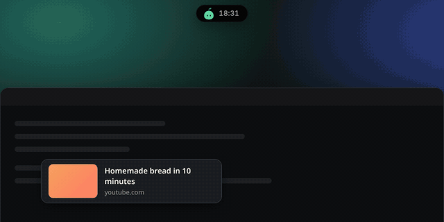

- **Drag and drop** a link, text or image from any program: the island opens to catch it.
- **Copy = save:** copy an Instagram, TikTok or YouTube link and it asks whether to save it, without taking you out of what you're doing (Windows only for now).
- **Screenshots:** copy a screenshot and it offers to save it (also Windows only for now).
- **It notifies you** about messages and reminders right there, and you can **reply to a message from the island** without opening the app: tap a friend (or a group) and the conversation shows up. If something went unseen, a little green light turns on.
- **Your music** (Spotify, YouTube Music, Apple Music, Deezer, Tidal, VLC and other music apps) stays in view, with the dancing bars; hover and you get **previous, pause and next**, the **album art**, the **lyrics** in time with the song, the **volume** and a **progress bar** you can jump around in. On **Linux** it works with desktop players, such as Spotify (not browsers).
- **Hover and it opens with tabs, and you choose which to show:** with the settings button (⚙) you turn on and off the ones you want. A fresh install starts with **Today, Focus, Friends, Notes, Saved and Apps**; Reminders, Groups and Alerts join when you want them. In **Reminders** you can **create** one right there (in 10 min, in 1 hour, tonight or tomorrow). In **Today** you see what you have today (with **"Join"** for your video calls) and your habits; in **Friends** you message anyone. All without opening the app.
- **Scenes:** in Apps you build your own combos, say Minecraft, Discord and Spotify: give them a name, pick the apps and one tap opens them all. If you like, the scene also starts a focus.
- **Habits with a time:** you check your habits off from the island and, for the ones you give a time, it nudges you at that time with **"Time for…"**, **Done** and **In 30 min**.
- **Write it your way:** in the notes field you can type something like "che, anotame que mañana tengo un examen" ("note that I have an exam tomorrow") or "recordame el jueves a las 9 llamar al contador" ("remind me Thursday at 9 to call the accountant"), and Teire AI understands it and does it. Anything that isn't a command is saved as a note, and if Teire AI can't (no internet, say), your text is kept as a note: it isn't lost. Teire AI understands Spanish only.
- **Command bar:** the **Notes** field also searches screens, notes, reminders and friends, and creates a note, a habit or a focus in one tap.
- **Pip on the pill:** closed, it shows what's most urgent (or the time, if there's nothing) and, the first time you open the island in each session, it greets you.
- **Focus mode:** pick what you're working on and for how long, and the island keeps the clock. If you want, notifications wait until you finish.
- **Notes pinned to your desktop:** pull a note or list out of the island and it floats like a sticky note, so you can tick things off.
- **Send things to your phone:** a link, a photo or something you copied reaches your phone in seconds.
- **Teire AI** answers on the island and, if you turned the voice on, it listens too (Spanish only for now).
- It hides itself when you're in a full-screen game or video.

## Teire Premium

Optional, for those who want to make it their own.

  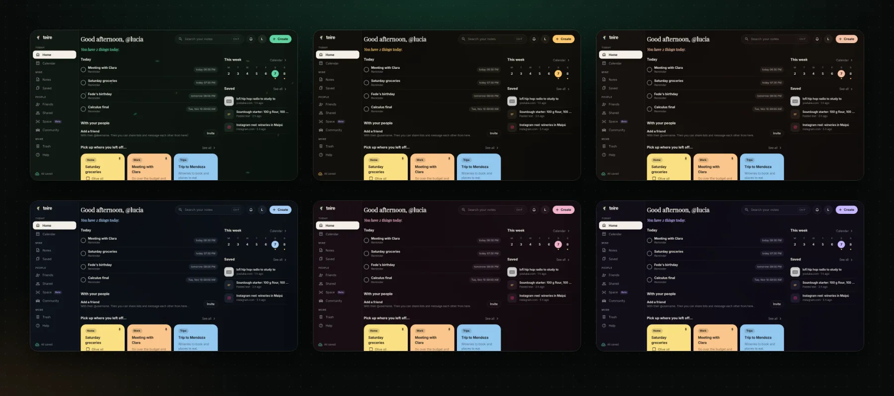

- **19 themes** for the whole app, in collections: Pastel, Vivid, Worlds and the ones made for Teire (**Garden**, **Gold** and **Paper**). Without Premium you can **try them for a minute**.
- **The golden mark:** Teire's little leaf in gold, on your chip and around your photo.
- **Colors for your notes**, for the island and for the Teire AI orb, plus a **glass island** or one **pinned to the top**, like a notch.
- **Triple the requests** to Teire AI.

You pay with **Mercado Pago** or **PayPal**, and you can **gift it to a friend** for 1, 3, 6 or 12 months.

## Download

  <a href="https://github.com/codewtato/teire-descargas/releases/latest"><b>Get the latest version</b></a>

All installers are in the [latest release](https://github.com/codewtato/teire-descargas/releases/latest):

| System | File |
|---|---|
| **Windows 10 / 11** | `Teire_…_x64-setup.exe` |
| **Android** | [`Teire.apk`](https://github.com/codewtato/teire-descargas/releases/latest/download/Teire.apk) |
| **iPhone** | No file: install it from Safari ([guide](https://useteire.app/en/iphone/)) |
| **Any Linux** | `Teire_….AppImage` |
| **Fedora / openSUSE** | `Teire-….rpm` |

Don't want to install anything? [Use it in your browser](https://useteire.app/app/) and sign in with your account, or with Google, Discord or GitHub. The island and Teire AI's voice aren't there, and notifications arrive while the tab is open.

### How to install

<b>🪟 Windows</b>

1. Open the `.exe` you downloaded.
2. If you see **"Windows protected your PC"**, click **More info → Run anyway**. That's normal for new apps that don't have a paid signature yet.
3. Follow the installer. Teire stays in the tray and **updates itself**.

<b>🤖 Android</b>

1. Download `Teire.apk` on your phone and open it.
2. Android will ask for permission to install apps from this source: allow it.
3. Future versions download and install from inside the app.

<b>📱 iPhone</b>

It's free and doesn't go through the App Store. You need iOS 16.4 or newer.

1. Open [useteire.app/app](https://useteire.app/app/) in **Safari**.
2. Tap **Share** (on newer iOS it may be inside **···**), then **Add to Home Screen** and **Add**.
3. Open Teire from its icon and **sign in there**: what you do in Safari doesn't carry over to the installed app.
4. Tap **Enable** to receive notifications.

Do you sign in with Google, Discord or GitHub? Tap **"Sign in with an email code"** and choose a password: it's the same account.

To save a link, copy it and tap **Paste** in Saved. If you want to save from Share without opening Teire, set up the shortcut.

The island and Teire AI's voice aren't available on iPhone. All the steps, including the shortcut and what to do if something fails, are in the [iPhone guide](https://useteire.app/en/iphone/).

<b>🐧 Linux</b>

- **AppImage:** `chmod +x Teire_*.AppImage` and open it with a double click. It updates itself.
- **Fedora / openSUSE:** `sudo dnf install ./Teire-*.rpm`.
- On **GNOME**, to see the tray icon you need the [AppIndicator](https://extensions.gnome.org/extension/615/appindicator-support/) extension.
- The **island** works on Linux too (with an account). Tested on Fedora with GNOME.

## FAQ

<b>Is Teire just a notes app?</b>

No, it's an organizer. It has notes, but also tasks, reminders, a calendar, focus mode and everything you share with your people: live lists, chat, groups and spaces.

<b>Do I need an account?</b>

No. Without an account your notes stay on your computer only. With an account they sync across your devices and you can share them. You can sign in with email, Google, Discord or GitHub.

<b>Is it free?</b>

Yes, and everything important is free. Teire Premium is optional: it adds themes, the golden mark, colors for your notes and the island (also in glass), and more Teire AI requests.

<b>Is Teire available in English?</b>

Yes: the app comes in English and Spanish, and picks the language of your device (change it in Profile → Appearance). Teire AI (voice and text) works in Spanish only for now.

<b>How do I invite someone to a Space?</b>

In your Space tap **Share** and create a link. Whoever opens it joins without an account and without installing anything. The link lasts 24 hours and you can close it earlier.

<b>Why does Windows show me a warning?</b>

Because the installer doesn't have a paid code signature yet, and Windows distrusts apps with few downloads. It doesn't mean it has a virus: the warning goes away over time.

<b>Does the island work on Linux or without an account?</b>

On Linux, yes (we tested it on Fedora with GNOME). Without an account, no: you need one, and you create it for free in the app. On Linux "Copy = save" and the screenshot prompt aren't there yet, and the music comes from desktop players such as Spotify.

<b>What happens with my data?</b>

Your notes are yours. There are no ads and we don't sell data. PIN-protected notes are encrypted on your device before they're uploaded, and what you drag from your computer into a note (except images) isn't uploaded: only the name is kept. It's all in the [privacy policy](https://useteire.app/en/privacy/).

<b>I found a problem or I have an idea</b>

Tell us from **Help** inside the app or in [Issues](https://github.com/codewtato/teire-descargas/issues).

---

  © 2026 Teire. Argentina. 
  This repository is the English showcase for <a href="https://useteire.app">useteire.app</a>. The installers are published in <a href="https://github.com/codewtato/teire-descargas">teire-descargas</a>; Teire's code is private. 
  <a href="https://useteire.app/en/privacy/">Privacy</a> · <a href="https://useteire.app/en/terms/">Terms</a> · <a href="https://useteire.app/en/withdrawal/">Right of withdrawal</a>

